<div align="center">

# DBPilot: project report

### Safe, tenant-aware autonomous optimisation for shared PostgreSQL

PostgreSQL 18 · FastAPI · React · Docker Compose · 275 automated tests + browser end-to-end tests

</div>

---

## Contents

1. [Abstract](#1-abstract)
2. [Introduction](#2-introduction)
3. [Problem statement, and a Tuesday it would have saved](#3-problem-statement-and-a-tuesday-it-would-have-saved)
4. [Methodology](#4-methodology) — architecture, tenancy, the digital twin, the safety gate, the canary
5. [Results](#5-results) — what worked, what broke, what the numbers say
6. [Discussion and limitations](#6-discussion-and-limitations)
7. [Conclusion](#7-conclusion)
8. [References](#8-references)
9. [Appendix: run it yourself](#9-appendix-run-it-yourself) — setup, demo walkthrough, API, tests, repository layout, status

> **How to read the numbers in this report.** Everything was measured on one development laptop, which
> [turned out to be a poor measuring instrument](#54-the-laptop-is-not-a-measuring-instrument). Nothing here is a claim
> about how DBPilot performs in general. Where a result is negative, it is reported as negative. Raw outputs and the
> protocols they were run under (written before each run) are in [docs/evidence](evidence/README.md); the short
> closing report is [docs/REPORT.md](REPORT.md).

---

## 1. Abstract

Software-as-a-service products commonly keep many customers ("tenants") in one PostgreSQL instance. A tuning change that
helps one tenant, such as an index, more memory or more parallel workers, can slow another, and judged on the workload
as a whole it can still look like a win. Language-model agents now propose such changes fluently, and the published
systems that use them are evaluated on aggregate metrics.

**DBPilot** is a control plane that treats every proposed change as a hypothesis. A proposer (fixed rules or an LLM
agent) may only choose from a closed set of typed actions. Each proposal then passes four tiers, cheapest first: static
rules, a planner what-if, a replay of captured production workload on a clone of the database (a *digital twin*) judged
**per tenant**, and a canary in production with automatic rollback. The per-tenant gate approves a change only when the
tenant it targets is *shown* to benefit and every other tenant is *shown* not to be harmed; anything uncertain is treated
as not safe.

The system is built and tested end to end: 275 automated tests, and browser tests that drive the whole loop on a running
stack, including a harmful change that the canary undid by itself when a tenant's p95 latency reached 3.69× its baseline
against a contract of 1.15×.

The measurements are more sobering, and more interesting, than the build:

- An A/A experiment (30 twin runs with *identical* arms) showed the first version of the gate declaring harm that did not
  exist in 2 of 9 verdicts. The gate was redesigned once, on that evidence, to judge replay *pairs*; on the same data it
  makes no false call (0 of 3,400 reordered sequences).
- With a slowdown of known size injected into real no-action replays, an **aggregate gate approved a change that slowed
  one neighbour by 20% in 20–43% of sequences**; the **per-tenant gate approved none**, and rejected 83–92% of 50%
  slowdowns given eight or more replay pairs.
- On a laptop, the per-tenant gate's caution has a price: it approved nothing at all, the harmless change included.
  Identical arms differ by 5–12% from pair to pair there, so no neighbour can be shown unharmed at a 5% margin in a
  practical number of replays.

- In 18 real trials the twin saw a useful index's benefit and agreed with production about its size, but ended
  inconclusive every time; and the canary once rolled back a change that did nothing.

No real change was found that harms a neighbour on this stack, so the twin has not been shown to catch one, and the LLM
agent has not been run against a live model. Both are stated as open, with the reasons.

## 2. Introduction

Database tuning used to be a person's job: a DBA who knew which index the reporting team would ask for next and which
setting had bitten them in 2019. Two things have changed.

First, **databases are shared**. One PostgreSQL instance per customer is expensive, so SaaS products put many customers
in one instance and separate them by role, row-level security or schema. The instance has one buffer cache, one set of
CPU cores, one write-ahead log, and one set of settings. Its tenants are neighbours in the full sense of the word.

Second, **the tuner is increasingly a machine**. Cloud providers recommend and apply indexes automatically
[[1]](#ref1), safe online tuners adjust live configurations [[2]](#ref2), and LLM-based systems read the manual and
propose settings [[3]](#ref3) [[4]](#ref4). These work, and they are evaluated the way single-database tuning has
always been evaluated: on one workload, by one aggregate number.

Put the two together and a gap appears. In a shared instance the aggregate can improve while one tenant gets worse, and
an average is a good place to hide a victim. A confident proposal from a language model does not change that; it only
makes the proposal arrive faster and sound better.

DBPilot's research question:

> Can an autonomous system safely optimise a shared multi-tenant PostgreSQL cluster by verifying each AI-proposed
> change in a digital twin, **per tenant**, before it reaches production? And what does that add over judging the
> workload as a whole, or over a canary alone?

**What this project contributes**

| | Contribution | Where |
|---|---|---|
| 🏗️ | A working three-plane system: control plane, multi-tenant data plane, experimentation plane with a real-clone digital twin | [§4](#4-methodology) |
| 🔒 | A closed, typed action space with stored inverses, so an agent can never run SQL and every change can be undone | [§4.8](#48-agent-and-action-space) |
| ⚖️ | A per-tenant safety gate built on replay pairs, with an aggregate gate as the comparison point | [§4.10](#410-verification-engine) |
| 🧪 | An honest account of validating that gate: an A/A experiment that caught it lying, the redesign, and a semi-synthetic power analysis | [§5](#5-results) |
| 📉 | Negative results worth having: why no "trap" scenario harmed a neighbour, and why a laptop cannot referee a 5% margin | [§5.4](#54-the-laptop-is-not-a-measuring-instrument), [§5.7](#57-things-that-went-wrong-and-what-they-taught) |

**What it does not claim.** Validating a change before applying it and reverting on regression is established practice
[[1]](#ref1) [[9]](#ref9); replaying captured workload on a test system is too [[10]](#ref10). DBPilot's twin is that
idea, not a new one. What the project set out to add is the per-tenant judgement in a shared instance, and its
measurement.

## 3. Problem statement, and a Tuesday it would have saved

### 3.1 Problem statement

Given one PostgreSQL instance shared by tenants *t₁ … tₙ*, each with latency objectives, and a stream of proposed
changes, each intended to help one tenant:

> **Apply a change only if** the target tenant's latency is shown to improve by a meaningful margin **and** no other
> tenant's latency is shown, or cannot be ruled out, to get worse by more than a small margin, **and** be able to undo
> it if production disagrees.

Three things make this harder than it sounds:

| Difficulty | Why |
|---|---|
| **Changes leak between tenants** | The tenants share memory, CPU, the log and (for instance-level settings) the configuration itself |
| **"No harm seen" is not "no harm"** | Failing to detect a slowdown in a noisy measurement proves nothing. Safety has to be *shown* (a non-inferiority test [[13]](#ref13)), which needs far more evidence than spotting a big win |
| **The proposer cannot be trusted to grade itself** | An LLM's explanation of why its change is safe is text, not a measurement |

Typical ways a change helps one tenant and hurts the rest:

| A change that helps one tenant… | …can hurt the others |
|---|---|
| An index that speeds up an analytics tenant's reads | Every write to that table now also maintains the index |
| More memory per sort for heavy reports | Less memory left when many small transactions run at once |
| More parallel workers per query | Fewer CPU cores for latency-sensitive transactions |
| Sending reports to a read replica | Stale results, or cancelled queries when the replica lags |

### 3.2 A scenario

*This story is an illustration. The company is invented; the mechanism is the one the project is about. What actually
happened when we measured it is in [Results](#5-results), and it is less tidy.*

**Tuesday, 02:13.** *Parcelly* sells a logistics platform. Four of its customers share one PostgreSQL instance:

| Tenant | What they do all day | What they care about |
|---|---|---|
| `t_steady` | Checkout: small transactions, constantly | 99% of requests under 100 ms |
| `t_bursty` | Flash sales: quiet, then six times the traffic | 99% under 150 ms |
| `t_analytic` | Dashboards: big reads over order lines | 95% under 2 s |
| `t_mixed` | A bit of everything | Both of the above |

`t_analytic`'s dashboards have become slow. The tuning agent notices a query filtering `order_line` by item with no index
to help it, and proposes one. It is right: the dashboards get about ten times faster.

**Without DBPilot.** The index goes on. The overall numbers look wonderful, because a ten-times win on heavy queries
outweighs almost anything in the total. Meanwhile every order line that `t_steady` writes now maintains one more index,
during a flash sale, and checkout slips past its 100 ms objective. The dashboard in the morning meeting is green. The
support ticket from `t_steady` arrives on Thursday.

**With DBPilot.**

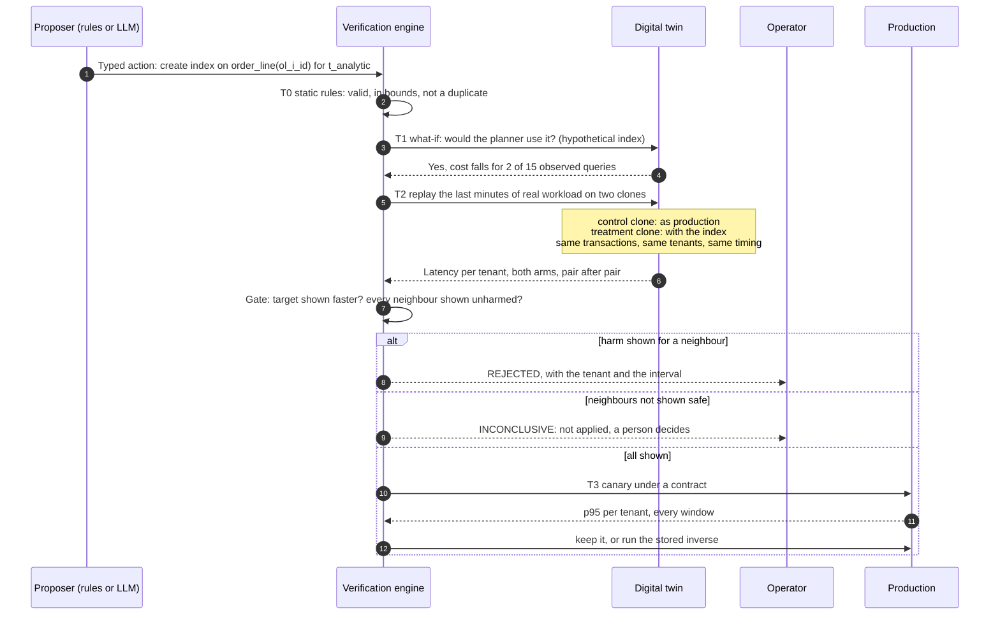

The difference is in step 7. An aggregate judgement asks "did the instance get faster?". DBPilot asks that question once
per tenant, and it asks it as "can you *show* me nobody got hurt?", which is a much less comfortable question.

<div align="center">
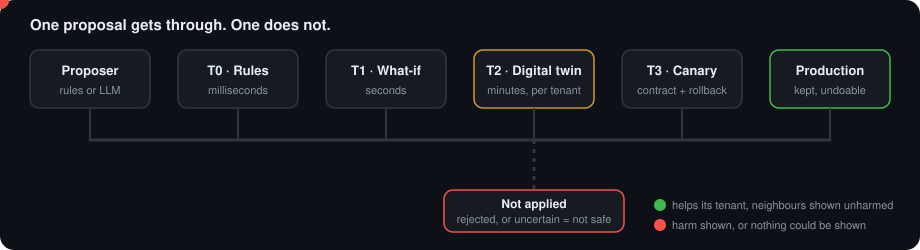
</div>

## 4. Methodology

The method is a pipeline in which evidence gets more expensive and more trustworthy at each step, and in which the
component that proposes is never the component that approves.

### 4.1 The loop and its four rules

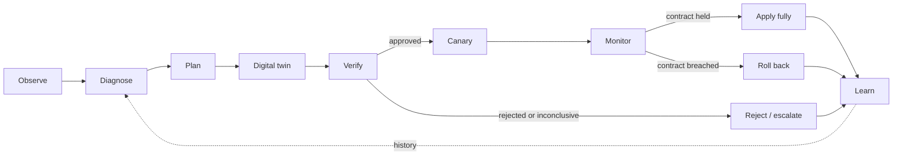

Four rules hold everywhere:

1. **The agent never executes SQL.** It chooses from a closed set of typed
   actions; a deterministic executor turns an approved action into SQL.
2. **The agent cannot approve its own proposal.** Verification is separate code.
3. **Every affected tenant is measured**, not just the one being helped.
4. **Uncertain is not safe.** A result that cannot be distinguished from harm is
   not approved.

### 4.2 Architecture

DBPilot is split into three planes so that experimentation can never disturb
what it is measuring.

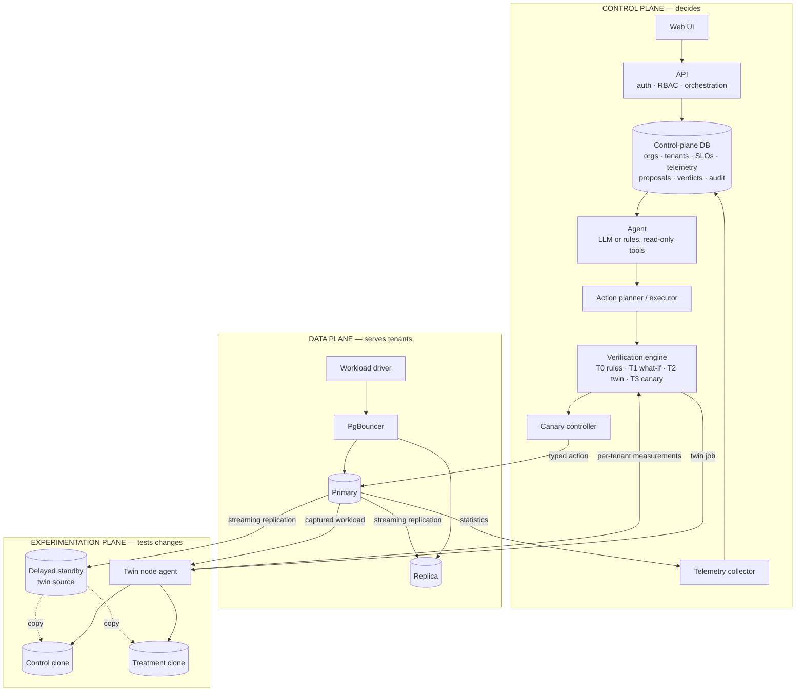

| Plane | Purpose | Why it is separate |
|---|---|---|
| Control | Stores state, decides, exposes the product | Must stay up and consistent regardless of load elsewhere |
| Data | Runs tenant workload | Is the thing being protected |
| Experimentation | Runs clones under replayed load | Replay is real load; on shared hardware it would distort production measurements |

In development all three run on one machine under Docker Compose, pinned to
disjoint CPU cores. For evaluation and cloud deployment the design places each
plane on its own node, with the experimentation node reserved for twin work.

### 4.3 Multi-tenancy model

Tenants share one database and the same tables. Three mechanisms keep them
apart and make them individually observable:

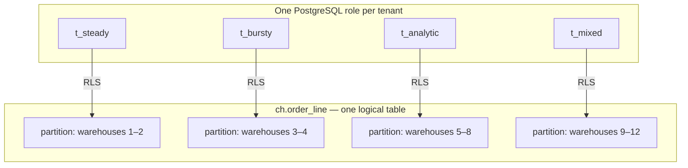

- **A role per tenant.** PostgreSQL's `pg_stat_statements` records statistics
  per role, so every query is attributed to a tenant with no proxy or tagging.
  Settings can also be changed for one role only.
- **Row-level security.** Each tenant owns a range of warehouse ids. A policy
  on every table restricts the role to its range. Tenants hold no privileges on
  the partitions themselves, so the policy cannot be bypassed.
- **A partition per tenant.** The six large tables are range-partitioned by
  warehouse id. PostgreSQL prunes other tenants' partitions at query start
  (`EXPLAIN` shows `Subplans Removed: 3`), and an index can be built for one
  tenant alone.

### 4.4 Control plane

A FastAPI service over its own PostgreSQL database.

#### Data model

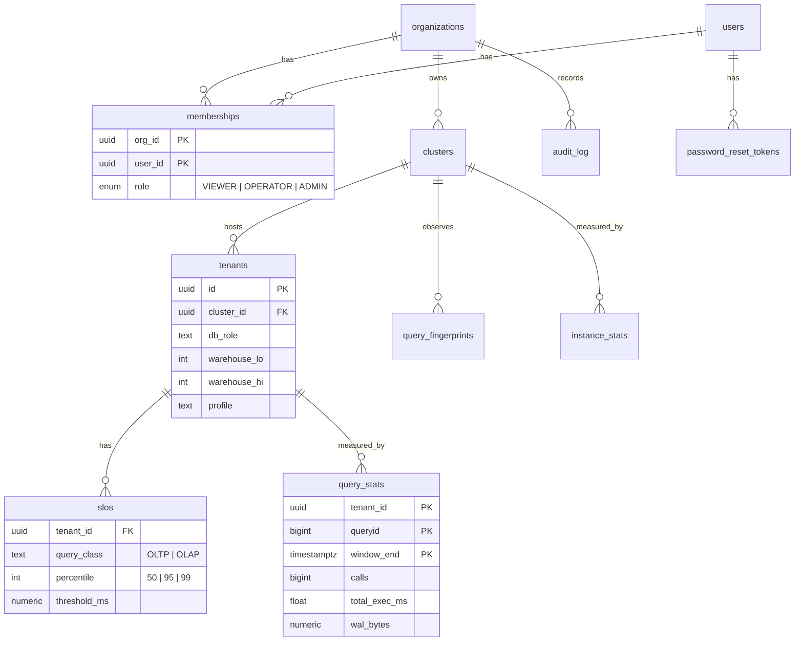

An **organization** is a DBPilot customer. It owns **clusters** (managed
PostgreSQL deployments), each hosting **tenants** (the customer's own
customers) with **SLOs** (for example "99% of OLTP requests under 100 ms").

#### Database concepts in use

| Concept | Where | What it guarantees |
|---|---|---|
| Normalised schema, M:N via `memberships` | `001_foundation.sql` | A user can belong to several organizations with a different role in each |
| Composite foreign keys | `tenants → clusters (id, org_id)` | A tenant cannot reference another organization's cluster |
| Exclusion constraint | `tenants_no_overlapping_ranges` | Two tenants in a cluster can never own overlapping warehouse ranges |
| Generated column | `users.has_password` | The API can tell an invite is pending without being able to read the hash |
| Row-level security | `003_security.sql` | Organization isolation and role checks enforced by PostgreSQL itself |
| `SECURITY DEFINER` functions | `004_auth_functions.sql` | Narrow, single-purpose access to credentials |
| Transactions | `cp.signup` | Organization, first user, membership and audit record commit together or not at all |
| Row locking | `cp.guard_last_admin`, `cp.consume_token` | Two admins demoting each other, or one reset token used twice, cannot both succeed |
| Triggers | `002_audit.sql` | Audit rows are written by the database; the log cannot be updated, deleted or truncated |
| Declarative partitioning | `cp.query_stats` by day | Old telemetry is dropped by partition; recent queries read recent partitions only |
| Keyset pagination on an index | audit API | Constant-time paging however deep |

#### Request path

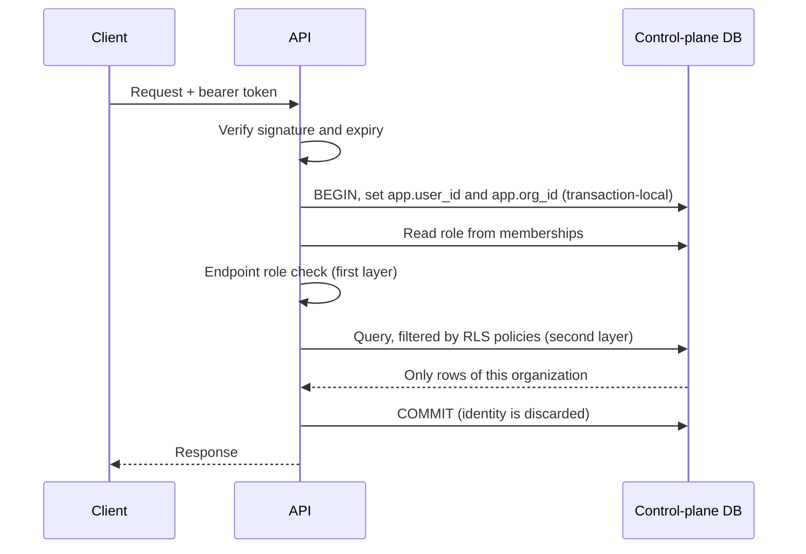

The role is read from the database on every request, not stored in the token,
so demoting or removing a member takes effect immediately.

### 4.5 Data plane

| Component | Role |
|---|---|
| Primary (PostgreSQL 18) | Serves tenant reads and writes; `pg_stat_statements`, `auto_explain` and HypoPG loaded |
| Replica | Hot standby by streaming replication through a replication slot, so the primary keeps the WAL it needs while it is stopped (up to 8 GB); target for read routing |
| PgBouncer | Connection pooler in transaction mode; the only way tenants connect |
| Seed job | Provisions four tenants and loads their data |

**Schema.** Derived from CH-benCHmark: the nine TPC-C tables (warehouse,
district, customer, history, orders, new_order, order_line, stock, item) plus
nation, region and supplier. The loader follows the TPC-C population rules: 10
districts per warehouse, 3,000 customers and 3,000 orders per district, 100,000
items, the last 30% of orders undelivered. The development seed loads 12
warehouses across four tenants, about 1.2 GB.

This schema follows the published specifications but is not an audited TPC
implementation. Results obtained with it are "CH-benCHmark-derived", never TPC
results.

**PgBouncer authentication.** Tenant roles are created at runtime, so PgBouncer
looks up each one's SCRAM verifier through a database function that answers
only for tenant roles. The database owner and service roles cannot be reached
through the pooler at all.

### 4.6 Workload driver

A tenant-aware load generator that connects through PgBouncer as each tenant.

- **Transactions.** The five TPC-C transactions in the specified mix: New-Order
  45%, Payment 43%, Order-Status 4%, Delivery 4%, Stock-Level 4%, with the
  specification's skewed random distributions and the 1% rollback rule.
- **Analytical queries.** Six CH-benCHmark queries (Q1, Q3, Q4, Q6, Q12, Q14)
  and one ad hoc item lookup.
- **Profiles.** Each tenant has streams with an arrival rate and optional
  periodic bursts ([`baseline.json`](../workload/profiles/baseline.json)).
- **Open loop.** Arrivals follow a Poisson schedule that does not depend on how
  fast the database answers, and latency is measured from the scheduled arrival
  time. A closed-loop generator slows itself down when the database is slow and
  under-reports the very latencies that matter (coordinated omission).
- **Output.** Per-interval and whole-run p50/p95/p99, throughput, errors and
  dropped arrivals for every tenant and class. This is the client-side ground
  truth used for evaluation, kept separate from what DBPilot itself observes.

### 4.7 Telemetry

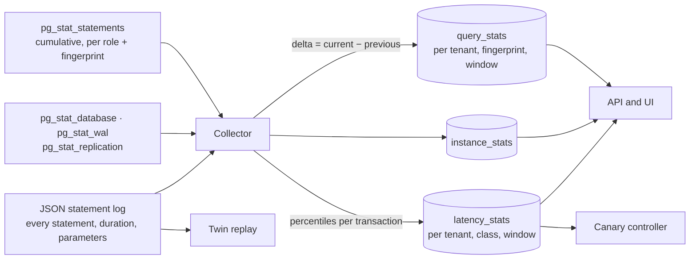

- **Query statistics.** PostgreSQL's counters only grow. The collector snapshots
  them and stores the difference between consecutive snapshots, so each row
  means "this tenant ran this query this many times, for this long, in this
  window". A statistics reset is detected and handled; a query first seen
  inside a window counts from zero.
- **Latency percentiles.** The primary logs every statement as JSON. A parser
  reassembles the log into transactions per tenant and class, which gives the
  p50, p95 and p99 that cumulative counters cannot. The same capture is what
  the digital twin replays.
- **On demand.** Execution plans (planned on the twin source, never on
  production), table and index profiles, and the current value of every
  tunable setting.

The collector runs with least privilege on both sides: a monitoring role on the
data plane that can read statistics but no table data, and a control-plane role
that can append telemetry but cannot read users, memberships or the audit log.

Capturing every statement is expensive (about 75 MB of log per minute at the
development workload). Its effect on latency has not been measured yet.

### 4.8 Agent and action space

Two proposers share one interface and one set of observations, so that a
comparison between them isolates the reasoning:

- **Rule-based proposer** — fixed runbook rules: tenant-scoped memory for a
  tenant whose queries spill to disk, an index when an expensive read filters
  an unindexed column *and* the planner confirms the gain, a statistics refresh
  for stale partitions, a concurrency cap for a tenant bursting while another
  misses its objective.
- **LLM agent** — given ten read-only tools (objective status, latency, top
  queries, tenant load, query plan, table profile, settings, what-if index,
  history, tenant list) and one tool with an effect, `propose_action`.

Whatever a proposer emits must validate against this closed action space.
Anything else is rejected before it reaches a database; the agent receives the
validation error and may correct itself.

| ID | Action | Scope | Inverse | Applied by executor |
|---|---|---|---|---|
| A0 | No action / escalate to a human | — | — | — |
| A1 | Create index | One tenant's partition, or all | Drop | Yes |
| A2 | Drop index (never one enforcing a constraint) | One index | Recreate from stored definition | Yes |
| A3 | Role-level setting (allowlisted, bounded) | One tenant | Previous value | Yes |
| A4 | Instance setting (reload-only, allowlisted, bounded) | Instance | Previous value | Yes |
| A5 | Refresh statistics | One table or partition | Nothing to undo | Yes |
| A6 | Route a tenant's reads to the replica | One tenant | Route back | Advisory only |
| A7 | Per-tenant concurrency cap | One tenant | Previous value | Yes |
| A8 | Query rewrite | — | — | Advisory only |

The executor derives both the statements that apply an action and the
statements that undo it, reading the current state so the inverse restores
exactly what was there. The same executor runs against the twin and against
production, so what was verified is what gets applied.

Every tool call the agent makes is stored with its proposal and shown in the
Agent Console. The agent loop is tested against a scripted model; it has not
yet been run against the live model API in this project.

### 4.9 Digital twin

The twin is a real PostgreSQL instance, not a simulation.

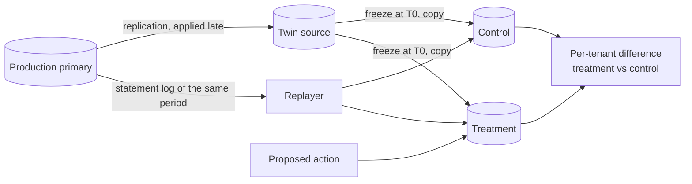

1. A standby deliberately applies production's changes late, so it is always at
   a known past moment for which the workload has already been captured.
2. On a run, its replay is paused, its position recorded, and its data
   directory copied. Each copy is started with a recovery target at exactly
   that position, exclusive; without it the copy would roll forward through the
   WAL it had received but not yet applied.
3. Every relation is loaded into memory on both clones, so both start equally
   warm. (Before this was added, whichever clone ran first looked about three
   times slower.)
4. The proposed action is applied to the treatment clone only.
5. The captured transactions are replayed against both at their original
   offsets, as their original tenant roles, with arm order alternating between
   repetitions.
6. Latency per tenant and class, write volume, storage growth and time to apply
   are reported to the control plane, which decides.

The twin node agent also answers planner what-if questions (hypothetical
indexes via HypoPG) and produces execution plans, both on the twin source.

### 4.10 Verification engine

Four tiers, cheapest first. A proposal stops at the first tier that rejects it.

| Tier | Check | Cost |
|---|---|---|
| T0 | Static rules: valid action, known tenant, not a duplicate, worst-case memory arithmetic | Milliseconds |
| T1 | Planner what-if: would any observed query use this index? | Seconds |
| T2 | Digital twin replay, judged by the gate below | Minutes |
| T3 | Canary in production under a rollback contract | Minutes |

**The gate.** For each tenant and class it computes treatment p95 ÷ control p95
with a confidence interval, corrected for the number of tenants compared. The
unit of evidence is the replay pair (one control replay and one treatment replay
of the same window): the interval is Student's t on the logarithm of each pair's
ratio, so its width comes from how much the pairs disagree. One pair decides
nothing, because the two arms run one after the other and differ by themselves;
an A/A diagnostic ([docs/evidence/e1](evidence/README.md)) showed identical
arms differing by 5–12% from pair to pair on the development laptop.

| Finding | Condition | Consequence |
|---|---|---|
| Benefit shown | Target's whole interval below 0.90 | Required for approval |
| Unharmed | Another tenant's whole interval below 1.05 | Required for every other tenant |
| Harm shown | A tenant's whole interval above 1.05, or an objective it was meeting is broken, and seen both with the treatment arm running first and with it running second | Reject |
| Uncertain | Interval straddles a limit, or too few samples | Replay another pair; still uncertain when the budget (`TWIN_MAX_LOOKS`, 3 by default, 8 on the laptop profile) is spent: inconclusive, escalated, never applied automatically |

**More evidence instead of a guess.** When the verdict is uncertain, the engine
replays a fresh window and judges all pairs together, up to the budget. Looking
several times would raise the chance of a false "safe", so each look is tested
at the error rate divided by the number of looks allowed. Every twin-verified proposal also records what
the other gate mode would have decided on the same measurements; that second
verdict decides nothing and exists for comparison.

Storage growth and write amplification are absolute budgets. Actions that are
expensive to undo face a tighter margin. An **aggregate** mode judges only the
pooled workload, as single-tenant tuners do; it exists as the comparison point.

The proposal lifecycle is a state machine enforced by a database trigger: no
code path, and not even the database owner, can move a proposal to production
without passing through verification, revive a rejected proposal, or edit an
action after it was proposed.

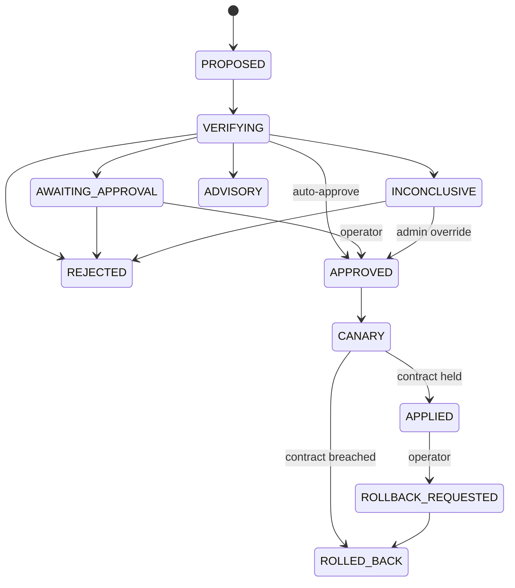

### 4.11 Canary and rollback

1. **Baseline.** Each tenant's p95 in the collector windows just before the change.
2. **Apply** with the executor; the statements and their inverse are stored.
3. **Watch.** Every window, observed p95 ÷ baseline is compared with the
   contract: the twin's prediction plus a tolerance, or a default limit when
   there was no twin. Two guards catch harm that latency does not show:
   deadlocks in the window, and how far the replica has fallen behind.
4. **Decide.** A breach in two of three windows, or telemetry missing for two
   windows, runs the inverse. Otherwise the change is marked applied.

**Staging.** An index for every tenant is built on one partition first (the
tenant the twin predicts to gain most) and on the others only after that
stage's windows held. Every other action is one stage. Exposing a setting to a
fraction of one tenant's sessions is in the design and not built: the pooler
cannot select a fraction of a role's connections.

**Tolerance.** How far production may drift from the twin's prediction starts
at 10%. Once the outcome ledger holds eight twin-versus-production comparisons
for an action type, the tolerance for that type becomes the 90th percentile of
the twin's past error.

Only one change may be in canary on a cluster at a time, so a regression can be
attributed. If the engine restarts and finds a change in canary, it rolls it
back: a change nobody was watching is treated as unsafe. An operator can also
roll back an applied change later; the stored inverse is used.

### 4.12 Learning loop

Every proposal leaves one record: proposal → verification steps → twin
prediction per tenant → canary observations → production result. A database
view joins them into the **outcome ledger**. The Experiments page is computed
from it: for each proposer and verification mode, how many proposals reached
production, how many harmed a tenant there, and how often the twin predicted
the direction production then showed. The agent can read the ledger through its
history tool.

The engine reads the ledger to set the canary tolerance per action type (see
§4.11). A learned model that predicts rejection is a later step that needs
far more history.

### 4.13 Security model

| Concern | Mechanism |
|---|---|
| Passwords | Argon2id hashes; the API's database role has no privilege to read them |
| Sessions | Signed, expiring tokens carrying only user and organization ids |
| Authorization | Role checked in the API and again by row-level security |
| Organization isolation | Row-level security; without a request context the API role sees zero rows |
| Reset and invite links | Random, single-use, expiring; only a SHA-256 hash is stored |
| Account probing | Login and password-reset responses are identical for known and unknown emails |
| Audit | Trigger-written, append-only, immutable even for the database owner |
| Tenant isolation | One role per tenant, row-level security, no privileges on partitions |
| Pooler | Admits tenant roles only |
| Service roles | Separate least-privilege roles for the API, the collector, the engine and monitoring |
| Executor | Logs in to the data plane as `dbpilot_executor`: not a superuser, `ALTER SYSTEM` on allowlisted parameters only, ADMIN on tenant roles only, and an event trigger refuses all DDL from it except `CREATE INDEX` and `DROP INDEX`. Limit: PostgreSQL has no privilege narrower than table ownership for building an index, so as a member of the owning role it could read or change rows |
| Secrets | Environment variables from an untracked `.env`; nothing hard-coded |

### 4.14 Technology stack

| Technology | Used for | Why this one |
|---|---|---|
| PostgreSQL 18 | Managed database and control-plane store | Row-level security, partitioning, rich statistics views, JSON plans and logs |
| `pg_stat_statements`, `pg_prewarm`, HypoPG | Per-tenant statistics, equal cache state on clones, planner what-if | Statistics keyed by role; test an index without building it |
| PgBouncer | Pooling, tenant-only login | The single door tenants use |
| FastAPI + psycopg 3 | API, collector, engine, twin node agent | Typed and async; SQL written by hand so the database features are visible |
| NumPy | Percentiles in the gate (the t interval is a few lines of its own) | The statistics are simple enough not to need more |
| Anthropic SDK (tool calling) | The LLM agent | Structured tool use; no agent framework |
| React + TypeScript + Recharts | Control-plane UI | An authenticated single-page app; no server rendering needed |
| Docker Compose | Running all three planes on one machine | One command reproduces every service and version |
| k3s | Three-node deployment (manifests written, not deployed) | Node placement and taints give real isolation between planes |
| pytest | Tests | Run inside the containers against real databases |

Deliberately not used: vector databases, agent frameworks, message queues.
Not yet added: Prometheus for host and container metrics.

## 5. Results

The short version, before the long one:

| Question | Answer | Kind of evidence |
|---|---|---|
| Does the system exist and work end to end? | **Yes** | 275 automated tests, browser tests on the running stack |
| Does the canary undo a harmful change by itself? | **Yes**, observed live | Browser test, one mechanism |
| Was the first safety gate trustworthy? | **No.** It reported harm between identical arms | A/A experiment, 28 valid runs |
| Is the redesigned gate trustworthy? | It makes **no false call** on the same data | Offline re-judgement, no new measurement |
| Does judging per tenant matter? | **Yes, under injected harm**: the aggregate gate approves what the per-tenant gate refuses | Semi-synthetic: real noise, synthetic effect |
| Can the per-tenant gate approve a safe change on a laptop? | **No.** It approved nothing | Same analysis, and 6 real twin trials, all inconclusive |
| Does the twin agree with production about a change's benefit? | **For the one case measured**, yes (0.11–0.16× against 0.12–0.15×) | 9 real trials of one index |
| Is the canary free of false alarms? | **No.** It rolled back a do-nothing change once in three | Real trials |
| Did the twin catch a real harmful change? | **Not shown.** None was found to catch | — |
| Is the LLM agent any good? | **Not shown.** Never run against a live model | — |

### 5.1 What is built and tested

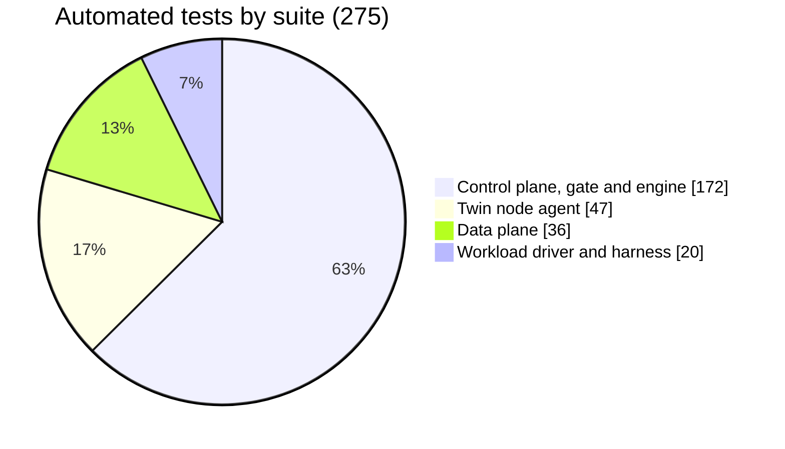

Tests run inside containers against real PostgreSQL instances, not mocks. A few of the things they prove: a VIEWER cannot
write even with raw SQL; organizations cannot see each other; the audit log cannot be altered, not even by the database
owner; no code path takes a proposal to production without verification; a tenant cannot reach another tenant's
partition; a clone is a standalone database at exactly the frozen moment; an agent's out-of-space output is bounced back,
not executed. The full table is in the [appendix](#a3-testing).

### 5.2 The loop, closed, in a browser

Three browser scenarios drive the running stack with a live demo workload:

| Scenario | What happened |
|---|---|
| A change under a canary | Applied, watched, kept, then rolled back on request with its stored inverse |
| The full loop through the twin | Proposal → static rules → planner what-if → 8 replay pairs → **INCONCLUSIVE** → an admin's recorded override → canary held → applied → rolled back |
| A harmful change | Dropping an index a tenant depends on. The canary saw that tenant's p95 at **3.69×** its baseline against a contract of **1.15×** and ran the inverse with nobody asking |

The twin verdict for the demo's missing index, exactly as the console shows it:

<div align="center">
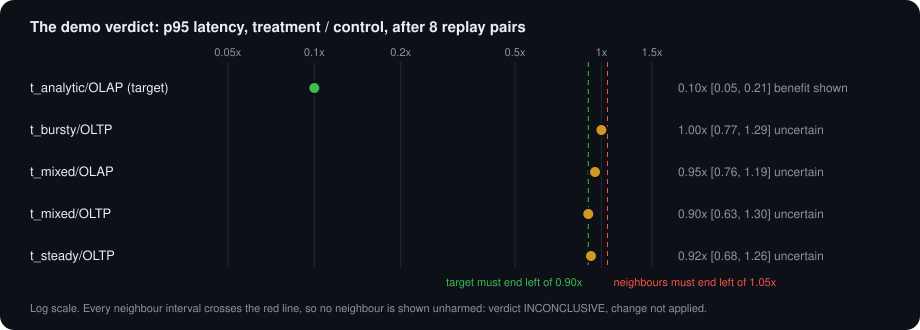
</div>

| Tenant / class | Control p95 | Treatment p95 | Ratio | Interval | Finding |
|---|---|---|---|---|---|
| `t_analytic/OLAP` (target) | 35.7 ms | 3.79 ms | 0.10× | 0.05 – 0.21 | Benefit shown |
| `t_bursty/OLTP` | 20.1 ms | 20.1 ms | 1.00× | 0.77 – 1.29 | Uncertain |
| `t_mixed/OLAP` | 516.9 ms | 513.9 ms | 0.95× | 0.76 – 1.19 | Uncertain |
| `t_mixed/OLTP` | 20.5 ms | 19.7 ms | 0.90× | 0.63 – 1.30 | Uncertain |
| `t_steady/OLTP` | 20.3 ms | 19.0 ms | 0.92× | 0.68 – 1.26 | Uncertain |

11,109 captured transactions, 8 replay pairs of 55 s, 4 replay errors, about 17 minutes. The target is unmistakably
faster. Every neighbour *looks* fine, and none can be *shown* fine: each interval reaches past 1.05×. With three pairs
instead of eight, even the target was uncertain (0.14×, interval 0.02 – 1.16). Verdict: inconclusive, not applied.

<details>
<summary><b>Screenshot: the proposal page in the console</b> (click to expand)</summary>

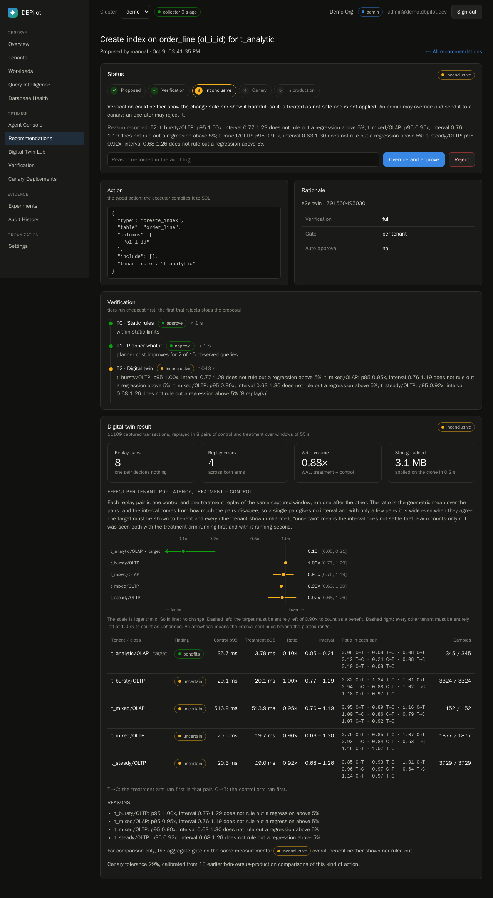

</details>

### 5.3 The gate that cried wolf (A/A experiment E1)

An A/A test gives both arms the *same* treatment: nothing. Any difference the system reports is its own invention
[[14]](#ref14). Thirty no-action twin runs were made under a protocol frozen and hashed beforehand; 28 were valid.

| | Gate v1: bootstrap over time buckets inside a replay | Gate v2: Student's t over replay pairs |
|---|---|---|
| False "harm shown" with identical arms | **2 of 9 verdicts** | **0 of 3,400** reordered sequences |
| Correct decisive verdict | 0 of 9 | 0 (inconclusive at 3, 5, 9, 14 and 28 pairs) |
| What its interval measures | Scatter of requests within one replay | Disagreement between pairs |
| What it cannot see | That two arms run one after the other differ by themselves | — |

The numbers behind it: run-to-run variation of the p95 ratio was **1.2 to 13.5 times** what gate v1's interval assumed.
Identical arms differed by −18% to +26% in typical request latency, and the tenants drifted *together*, which is what a
machine changing speed between two sequential replays looks like.

The redesign (made once, on this evidence, and then frozen):

- the unit of evidence is the **replay pair**; one pair decides nothing;
- the interval is Student's t on the logarithm of each pair's ratio, so its width comes from how much the pairs disagree;
- **harm must replicate with each arm having run first**, so "whoever goes second is slower" cannot pass as harm;
- a bootstrap over pairs was tried and rejected: with three pairs its nominal 95% interval covered the truth 75% of the
  time on the A/A data.

Gate v2 is honest. It is also, on this machine, unable to say yes; see below.

### 5.4 The laptop is not a measuring instrument

| Observation | Value |
|---|---|
| Speed variation under sustained load (synthetic CPU soak, database idle) | **5 – 24%**, following CPU frequency, with no operating-system indicator of a limit |
| CPU used by the *same* workload profile in different sessions | 220% to 396% of a core |
| Identical twin arms, pair to pair | **5 – 12%** apart |
| Charger drop-outs during runs | Several; they line up to the second with the anomalies they caused |

A gate with a 5% margin is being asked to hear a whisper at a concert. Showing a neighbour unharmed at that margin would
take tens to a hundred replay pairs here; a verdict with eight already takes 17 minutes.

### 5.5 What each gate decides when the harm is known (semi-synthetic)

No real change was found that harms a neighbour (see [§5.7](#57-things-that-went-wrong-and-what-they-taught)), so the
decision rule was examined another way. Into the 28 real no-action replay pairs, a slowdown of known size was injected
into one neighbouring tenant's class in the treatment arm, and the target's class was made faster by the factor the demo
index showed (0.10×). **The noise is real; the effect is not.** This says what the rule does with an effect of a given
size under this machine's noise. It does not say the twin reproduces production, and it is not the twin catching a
regression. Protocol: [tools/final/protocol.md](../tools/final/protocol.md), committed before the analysis was run.

<div align="center">
</div>

Target `t_mixed` (its analytical class is a large share of total database time); neighbours pooled; 20 random orderings
of the pairs. The draws are dependent, so the rates are indicative.

| Slowdown of one neighbour | Per-tenant gate: **rejected for harm** (8 / 14 / 28 pairs) | Per-tenant gate: approved | Aggregate gate: **approved** (8 / 14 / 28 pairs) |
|---|---|---|---|
| none | 0% / 0% / 0% | 0% | 57% / 65% / 65% |
| +5% (the margin) | 0% / 0% / 0% | 0% | 43% / 66% / 67% |
| +10% | 3% / 4% / 3% | 0% | 39% / 55% / 63% |
| +20% | 31% / 42% / 53% | 0% | **20% / 28% / 43%** |
| +50% | 83% / 85% / 92% | 0% | 3% / 5% / 7% |
| +100% | 88% / 94% / 100% | 0% | 1% / 0% / 0% |

What it shows:

- 🛡️ **The per-tenant gate let no injected harm through**, at any size or budget.
- 🫥 **The aggregate gate approved a change that slowed a neighbour by 20% in 20–43% of sequences.** The target's gain
  outweighs the victim in the total. This is the effect the project is about.
- 🔍 Slowdowns of 10–20% the per-tenant gate mostly could not tell from noise. It held them as inconclusive, which blocks
  the change without identifying the harm.
- 🪙 **The advantage depends on the workload.** With target `t_analytic`, whose class is a small share of total time, the
  aggregate gate approved almost nothing (at most 5%), harmful or not. It was not protecting anyone; it simply could not
  see a benefit that small in the total.
- ⏱️ **Three pairs are not enough**: the per-tenant gate rejected only 16% of +50% slowdowns and 36% of +100%.
- 🧱 **The per-tenant gate approved nothing, including the harmless change.** On this machine its price is that nothing
  passes without a person.

Full tables, per neighbour and with the stalled pair left out: [docs/evidence/final/power.txt](evidence/final/power.txt).

### 5.6 Real changes through the real loop

Two real changes, three ways of handling them, on the harness's own workload: the missing index for the analytical
tenant and a change that does nothing (a statistics refresh); each with no verification, with a canary only, and with
the twin and the per-tenant gate at a budget of 8 replay pairs; 3 repetitions of each. All 18 trials are valid: no
harness error, replay errors at most 12 of about 22,500 transactions (0.05%), no change of power source during the run.

| Change | Handling | Outcome (3 trials) | Time to decision |
|---|---|---|---|
| Missing index | No verification | Applied ×3 | 70 – 80 s |
| Missing index | Canary only | Applied ×3, canary held | 75 – 80 s |
| Missing index | Twin, per-tenant gate | **INCONCLUSIVE ×3**, not applied (8 pairs each) | 1,021 – 1,031 s |
| No-op | No verification | Applied ×3 | 65 – 75 s |
| No-op | Canary only | Applied ×2; **rolled back by the canary ×1** | 60 – 80 s |
| No-op | Twin, per-tenant gate | **INCONCLUSIVE ×3**, not applied (8 pairs each) | 1,016 – 1,066 s |

**The twin and production agree about the target of the index.**

| `t_analytic/OLAP` p95 ratio | Values |
|---|---|
| Twin, treatment ÷ control (3 trials) | 0.126× [0.08, 0.20], 0.114× [0.08, 0.16], 0.156× [0.10, 0.25] |
| Production, live ÷ mean(before, after) (6 trials, client side) | 0.12× to 0.15× |

That is six production trials and three twin verdicts for one kind of action. It is encouraging; it is not a validation
of the twin.

**The twin could not show any neighbour unharmed.** For the index its neighbour ratios were 0.98× to 1.07×, with
intervals as wide as 0.65 – 1.47. For the no-op, where the true ratio of every tenant is 1, the ratios were 0.93× to
1.10× with intervals up to 0.81 – 1.35. Every one of the six verdicts was INCONCLUSIVE for that reason.

**Production's own measurements are just as noisy.** With the index applied, OLTP classes sat at 0.94× to 1.03×. One
class, `t_mixed/OLAP`, measured 1.06× to 1.16× in the unverified trials (two of the three had enough samples to measure it)
and 0.93× to 1.03× in the canary trials, with the *same* change. The harness's 10% threshold flagged a tenant as "harmed" twice, once by the index and once by a statistics
refresh. Neither is reported as a finding, as the protocol said in advance.

**A finding that was not expected: the canary rolled back a change that did nothing.** In one no-op trial the canary saw
`t_mixed/OLAP` at 1.27× its baseline against a contract of 1.15× in two of three windows and undid the statistics
refresh. The load generator's own measurement of that tenant over the same period was 1.03×. The cause is how little the
canary has to go on: a 20-second window holds only a handful of that tenant's analytical queries, and a p95 over a
handful of samples moves by tens of percent by chance. So the canary's contract has a false-alarm rate on low-traffic
classes that was not measured before, and one in three is all this run can say about it.

**The aggregate gate on the same twin measurements** (recorded for comparison, deciding nothing): INCONCLUSIVE for the
index all three times, and REJECT for no benefit for the no-op all three times, which is the correct decisive answer
there. The per-tenant gate reached no decisive answer in any of the six.

**Against what the protocol said to expect:**

| Expectation, written before the run | Result |
|---|---|
| The index makes its target several times faster and no neighbour is consistently slower | Held |
| The index under the twin ends INCONCLUSIVE with the target's benefit shown | Held, 3 of 3 |
| The no-op under the twin ends INCONCLUSIVE or rejected for no benefit; never approved, never rejected for harm | Held, 3 of 3 |
| (Nothing was stated about the canary) | A false rollback of a no-op, 1 of 3 |

The twin gate cost about 17 minutes a verdict against about 75 seconds for a canary, and approved neither change.
Records: [evidence/final/trials.jsonl](evidence/final/trials.jsonl); computed report:
[evidence/final/trials_report.txt](evidence/final/trials_report.txt).

### 5.7 Things that went wrong, and what they taught

These are the findings the project did not plan to have. They changed its design more than anything that went right.

**The traps did not bite.** The scenario suite contained changes designed to help one tenant and hurt another. Measured
at the class-level p95 the objectives are written in, none did:

| Trap | Why it did nothing |
|---|---|
| More parallel workers | The row-security helper functions are marked parallel-unsafe, so **no tenant query ever runs in parallel**. An early "1.3× slowdown" was machine drift, measured before/after with no control |
| An index built for every tenant | OLTP latency here is about 85% round trips outside the database; maintaining one more index is lost in it |
| Anything touching one query | Class-level p95 is set by the slowest kind of operation in the class, so a query that becomes many times faster or slower can leave it unchanged |
| Raising load to make contention visible | Ran into a lock convoy on each tenant's few warehouses, which collapses the run instead of degrading it |

**Bugs found by using the system rather than testing it:**

| Bug | Effect | State |
|---|---|---|
| The capture recorded the pooler's own `SET application_name` as tenant transactions | For a tenant with two connection classes, half of one class's replay samples were no-ops | Fixed |
| The planner what-if judged a tenant's index across *every* tenant's partition | It could save only that partition's share, so the demo's own index was rejected | Fixed |
| Whichever clone ran first looked about three times slower | Cold cache | Fixed: every relation is loaded into memory on both clones |
| A clone rolled forward one transaction past its frozen moment | Arms did not start from the same state | Fixed: exclusive recovery target |
| The canary measures latency inside the database | Harm that is only queueing at the pooler (a one-connection cap) is invisible to it | **Not fixed.** Stated |

### 5.8 Scoreboard

| ✅ Shown | ❌ Not shown |
|---|---|
| The whole loop runs: propose, verify in four tiers, decide, canary, apply, roll back | That the twin gate approves a safe change (on this laptop it cannot) |
| The canary rolls back a harmful change automatically | That the twin catches a *real* harmful change (none was found) |
| A gate that resamples within a replay reports false harm; one that judges pairs does not | That the twin's prediction matches production in general (it matched for one index; nothing else was measured) |
| Under injected harm, an aggregate gate approves what a per-tenant gate refuses | Anything about the LLM agent's proposals |
| Typed actions, stored inverses, least-privilege roles and a trigger-enforced lifecycle hold under test | Rates with meaningful confidence intervals, for anything |

## 6. Discussion and limitations

**Safety is expensive, and the bill is paid in pairs.** Showing a big benefit is cheap: a ten-times speed-up is visible
after a few replays. Showing that four other tenants are each within 5% of where they were is a different order of
problem, because the claim is about the absence of a small effect in a noisy measurement. Most of the project's
surprises are this one fact arriving from different directions.

**The twin's arms run one after the other.** That is the design's weakest point on a noisy machine: anything that
changes between the two replays (CPU frequency, a background task, a charger) lands entirely in the difference.
Duet benchmarking [[6]](#ref6) runs both versions *at the same time* on the same machine so that such disturbances hit
both, and reports accuracy gains of 2 to 80 times in the cloud. The A/A data shows tenants drifting together between
sequential arms, which is the kind of noise concurrent arms cancel. This is the first thing a continuation should try.

**An inconclusive verdict is a real outcome, not a failure message.** It blocks the change and asks a person. That is
the correct behaviour for "I could not show this is safe", and it is also why a gate that only ever says "inconclusive"
is not yet useful for autonomy.

**Limitations, plainly:**

- One laptop; all three planes share its CPU and disk; dataset at 0.3 scale and half rate. Variability on shared hardware
  is well documented [[7]](#ref7) [[8]](#ref8), and this was worse than shared hardware.
- The injected effect in §5.5 is a uniform slowdown. Real harm can have other shapes (only the tail, only during bursts).
- No real cross-tenant harm exists in the action space on this stack, so the central claim is supported by a
  semi-synthetic analysis only.
- The LLM agent is tested against a scripted model, never a live one (no API key was available).
- The canary cannot see queueing at the pooler, and on a low-traffic class its 20-second windows hold too few
  queries for a steady p95: it rolled back a do-nothing change in one of three trials.
- The related-work search was focused, not systematic. No system was found that gates an automatically proposed change
  on per-tenant non-inferiority in a shared instance; that is the absence of a result in a short search, not evidence
  that none exists. **No novelty is claimed.**

## 7. Conclusion

DBPilot set out to answer whether an autonomous tuner can be made safe for a shared database by checking each change on
a twin, tenant by tenant. The honest answer after building it is in three parts.

**The machinery is real.** A proposer that cannot run SQL, an executor that can undo what it does, a clone frozen at a
known moment and replayed with production's own workload, a gate, a canary, a ledger, and a console over all of it, exist
and are tested. The loop closes in a browser, and the canary has pulled a harmful change back out of production without
being asked.

**The idea survives contact with evidence, in the one form we could test it.** When a neighbour is slowed by a known
amount under real measurement noise, judging the workload as a whole approves the change a substantial part of the time,
and judging each tenant does not. That is the reason to gate per tenant.

**The measurement is the hard part, and it is not solved here.** The first gate was confidently wrong; finding that out
took an experiment whose only purpose was to catch our own tool lying. The second gate is honest and, on a laptop, cannot
say yes. Whether steadier hardware and concurrent arms close that gap is the open question, and the repository contains
the protocol and runner to answer it.

If there is one thing to take from the project, it is that *"we did not see any harm"* and *"we showed there was none"*
are different sentences, and that most of the engineering lives in the distance between them.

**What a continuation should do first**

1. Run the two twin arms at the same time on separate cores, as duet benchmarking does, and repeat the A/A measurement.
2. Repeat it on a machine whose cores are not shared and whose speed is steady (`tools/aa/run_linux.sh`).
3. Only if neighbours can then be shown unharmed in a practical number of pairs, run the scenario suite.
4. Find a real cross-tenant harm before claiming anything about catching one. The honest candidates: CPU contention once
   the row-security helpers are parallel-safe, and write-heavy tenants at the full-size dataset.
5. Give the canary a measure of client-side waiting, and longer windows or a minimum sample count that makes a p95
   meaningful for low-traffic classes.
6. Run the LLM agent against a live model and compare what it proposes with the rules.

### 7.1 Added after the closing evaluation

Three small features were added once the evaluation was finished. They are reading aids: none of them changes what the
gate, the engine or the canary decides, so the system that was measured in section 5 is the system that decides today.

- **Canary noise check** (Canary Deployments page; `GET /clusters/{id}/canary-noise`; `controlplane/app/planning.py`).
  The canary's own rule is replayed over recent telemetry, leaving out the moments when DBPilot applied or undid a
  change. Whatever it would have rolled back is a false alarm. It was prompted by the false rollback in Part B. On the
  three hours that included the closing trials it flagged 95 of 344 stretches (28%), most often the class with a median
  of 7 transactions per 20-second window. That period also contains workload restarts between trials, twin replays and
  test runs on the same machine, which the check does not leave out, and the stretches overlap; so the figure is an
  indication that the canary's rule is fragile here, not a false-alarm rate.
- **Pairs to show unharmed** (twin result table). For each tenant and class, the number of replay pairs at which its
  interval would fit under 1.05x if its ratio and the disagreement between pairs stayed as measured. It solves the
  gate's own condition for the number of pairs; it is an estimate and is labelled as one.
- **Download evidence** (proposal page). Everything recorded about a proposal as one JSON file.

Tests after these additions: control plane, gate and engine 183 (was 172; 11 new in `tests/test_planning.py`); the
browser tests check the new card, the new column and the download.

Suggested and deliberately not built, because each changes a decision or a measurement and would need its own
validation first: running the twin's two arms at the same time; a canary guard on waiting at the pooler; canary windows
sized by sample count instead of by time.

Test counts elsewhere in this report (275 in total, 172 for the control plane) are those at the time of the
evaluation; the control-plane suite now has 183.

## 8. References

This project has no single base paper; it sits between two lines of work. The closest in spirit are **[1]** (validate an
automatic change, revert on regression, at scale) and **[2]** (safety constraints while tuning a live database), with
**[6]** as the paper that explains what our measurements were missing.

**Automatic tuning with validation**

1. <a id="ref1"></a>S. Das et al. *Automatically Indexing Millions of Databases in Microsoft Azure SQL Database.* SIGMOD 2019. [doi:10.1145/3299869.3314035](https://doi.org/10.1145/3299869.3314035)
2. <a id="ref2"></a>X. Zhang et al. *Towards Dynamic and Safe Configuration Tuning for Cloud Databases* (OnlineTune). SIGMOD 2022. [doi:10.1145/3514221.3526176](https://doi.org/10.1145/3514221.3526176)
3. <a id="ref3"></a>J. Lao et al. *GPTuner: A Manual-Reading Database Tuning System via GPT-Guided Bayesian Optimization.* [arXiv:2311.03157](https://arxiv.org/abs/2311.03157)
4. <a id="ref4"></a>V. Giannakouris, I. Trummer. *λ-Tune: Harnessing Large Language Models for Automated Database System Tuning.* [arXiv:2411.03500](https://arxiv.org/abs/2411.03500)
5. <a id="ref5"></a>Z. Tan, S. Babu. *Tempo: Robust and Self-Tuning Resource Management in Multi-tenant Parallel Databases.* PVLDB 9(10), 2016. [doi:10.14778/2977797.2977799](https://doi.org/10.14778/2977797.2977799) · [PDF](https://www.vldb.org/pvldb/vol9/p720-tan.pdf)

**Measuring on machines that will not hold still**

6. <a id="ref6"></a>L. Bulej et al. *Duet Benchmarking: Improving Measurement Accuracy in the Cloud.* ICPE 2020. [doi:10.1145/3358960.3379132](https://doi.org/10.1145/3358960.3379132) · [arXiv:2001.05811](https://arxiv.org/abs/2001.05811)
7. <a id="ref7"></a>A. Maricq et al. *Taming Performance Variability.* OSDI 2018. [usenix.org](https://www.usenix.org/conference/osdi18/presentation/maricq)
8. <a id="ref8"></a>A. Uta et al. *Is Big Data Performance Reproducible in Modern Cloud Networks?* NSDI 2020. [usenix.org](https://www.usenix.org/conference/nsdi20/presentation/uta)

**Industrial practice**

9. <a id="ref9"></a>Oracle. *Database Administrator's Guide: Managing Indexes* (automatic indexing). [docs.oracle.com](https://docs.oracle.com/en/database/oracle/oracle-database/19/admin/managing-indexes.html)
10. <a id="ref10"></a>Oracle. *Database Testing Guide* (Database Replay). [docs.oracle.com](https://docs.oracle.com/en/database/oracle/oracle-database/19/ratug/)

**Workload and statistics**

11. <a id="ref11"></a>R. Cole et al. *The Mixed Workload CH-benCHmark.* DBTest 2011. [doi:10.1145/1988842.1988850](https://doi.org/10.1145/1988842.1988850)
12. <a id="ref12"></a>Transaction Processing Performance Council. *TPC-C Benchmark.* [tpc.org/tpcc](https://www.tpc.org/tpcc/)
13. <a id="ref13"></a>D. Schuirmann. *A Comparison of the Two One-Sided Tests Procedure and the Power Approach for Assessing the Equivalence of Average Bioavailability.* J. Pharmacokinetics and Biopharmaceutics, 1987. [doi:10.1007/BF01068419](https://doi.org/10.1007/BF01068419) (why "no significant difference" is not "equivalent")
14. <a id="ref14"></a>R. Kohavi, D. Tang, Y. Xu. *Trustworthy Online Controlled Experiments.* Cambridge University Press, 2020. [experimentguide.com](https://experimentguide.com/) (A/A tests)

**Tools and study material**

15. <a id="ref15"></a>HypoPG: hypothetical indexes for PostgreSQL. [github.com/HypoPG/hypopg](https://github.com/HypoPG/hypopg)
16. <a id="ref16"></a>PostgreSQL documentation: [row security policies](https://www.postgresql.org/docs/current/ddl-rowsecurity.html) · [pg_stat_statements](https://www.postgresql.org/docs/current/pgstatstatements.html) · [table partitioning](https://www.postgresql.org/docs/current/ddl-partitioning.html) · [standby servers](https://www.postgresql.org/docs/current/warm-standby.html)
17. <a id="ref17"></a>PgBouncer. [pgbouncer.org](https://www.pgbouncer.org/)
18. <a id="ref18"></a>G. Tene. *wrk2* and the note on coordinated omission. [github.com/giltene/wrk2](https://github.com/giltene/wrk2)

**In this repository:** [closing report](REPORT.md) · [architecture specification](ARCHITECTURE.md) ·
[learning guide](LEARNING_GUIDE.md) (every technology used, explained from scratch) ·
[evidence and protocols](evidence/README.md)

---

## 9. Appendix: run it yourself

### A.1 Getting started

Requirements: Docker with Compose, about 16 GB of memory, 20 CPU threads for the
default core pinning (edit the `cpuset` values in `docker-compose.yml` for a
smaller machine).

Create a file named `.env` in the repository root with the variables below and
your own values. It is gitignored; never commit it.

```bash
# Control plane
CONTROL_DB_OWNER_PASSWORD=       # database owner, runs migrations only
CONTROL_DB_API_PASSWORD=         # unprivileged role the API logs in as
CONTROL_DB_COLLECTOR_PASSWORD=
CONTROL_DB_ENGINE_PASSWORD=
JWT_SECRET=                      # at least 32 characters: python -c "import secrets; print(secrets.token_urlsafe(48))"
PUBLIC_WEB_URL=http://localhost:5173
CORS_ORIGINS=http://localhost:5173

# Data plane
DATAPLANE_OWNER_PASSWORD=
DATAPLANE_REPLICATION_PASSWORD=
DATAPLANE_PGBOUNCER_AUTH_PASSWORD=
DATAPLANE_MONITOR_PASSWORD=
DATAPLANE_EXECUTOR_PASSWORD=     # the role the engine applies changes as
DATAPLANE_TENANT_PASSWORD=       # development seed: shared by the four demo tenant roles
SEED_SCALE=1.0                   # 1.0 = TPC-C population; smaller loads faster
SEED_ITEMS=100000
COLLECT_INTERVAL_S=60

# Experimentation plane
TWIN_TOKEN=
TWIN_DELAY_S=180                 # how far the twin source trails production
TWIN_WINDOW_S=120                # length of workload replayed; at most TWIN_DELAY_S
TWIN_REPETITIONS=2
TWIN_MAX_LOOKS=3                 # replay pairs a verdict may use before escalating; one pair decides nothing

# Demo organization created by demo-seed
DEMO_ADMIN_EMAIL=admin@demo.dbpilot.dev
DEMO_ADMIN_PASSWORD=             # at least 10 characters

# LLM agent (optional); leave empty to use only the rule-based proposer
ANTHROPIC_API_KEY=
AGENT_MODEL=claude-opus-5-5
```

Then:

```bash
docker compose up -d --build    # control plane, data plane, twin, web
docker compose run --rm dp-seed     # load four tenants (about 5 minutes)
docker compose run --rm demo-seed   # register them as a demo organization
```

#### Resource profiles

On one machine the three planes share memory and disk, so sizes are variables.
The defaults in `docker-compose.yml` are the full-size profile; a 16 GB laptop
should add the smaller profile to `.env` before the first start:

| Variable | Full size (default) | 16 GB laptop |
|---|---|---|
| `SEED_SCALE` / `SEED_ITEMS` | 1.0 / 100000 (about 1.5 GB) | 0.3 / 30000 (about 380 MB) |
| `DP_SHARED_BUFFERS` (primary and twin clone) | 2GB | 512MB |
| `STANDBY_SHARED_BUFFERS` (replica, twin source) | 256MB | 128MB |
| `DP_MEM_LIMIT` / `REPLICA_MEM_LIMIT` / `TWIN_MEM_LIMIT` | 6g / 4g / 8g | 1536m / 768m / 1536m |
| `TWIN_REPETITIONS` | 2 | 1 |
| `TWIN_MAX_LOOKS` | 3 | 8 (short windows need more pairs; about 17 minutes per verdict) |
| `EVAL_RATE_SCALE` / `EVAL_POOL_SIZE` | 1.0 / 16 | 0.5 / 8 |
| `LOG_RETENTION_MIN` | 0 (keep the hour) | 15 |

At `SEED_SCALE` below 1.0 the data no longer has the TPC-C population per
district; measurements taken with it must say so. Changing the seed variables
after the first start has no effect until the data-plane volumes are recreated.

#### Walking through the demo

```bash
docker compose --profile demo up -d demo-load     # the four tenants send light traffic until stopped
docker compose --profile demo stop demo-load
```

Open http://localhost:5173 and sign in with `DEMO_ADMIN_EMAIL` /
`DEMO_ADMIN_PASSWORD` from `.env`. The top bar shows how long ago the collector
last reported; after two collector windows the Overview, Workloads and Query
Intelligence pages fill in. Without the demo workload the charts are empty and
the Overview says so.

The demo workload has the analytical tenant look items up in `order_line`, which
has no index on the item. From there:

1. **Agent Console → Run rule-based proposer** queues what its rules find, the
   missing index among them (or propose it by hand under Recommendations, from
   the "Index for one tenant" template).
2. The proposal's page shows where it is: static rules, planner what-if, then the
   digital twin, which replays several pairs of about two minutes each.
3. The twin result shows each tenant's ratio with its interval and the ratio in
   every replay pair. On one laptop, where the planes share a machine, the
   neighbours' intervals are too wide to show them safe, so the verdict is
   usually **inconclusive**: the change is not applied.
4. An operator rejects it, or an admin overrides and sends it to a canary. The
   canary applies it to production, watches every tenant against the contract,
   and keeps it or undoes it.
5. **Roll back** undoes an applied change with its stored inverse. Experiments and
   Audit History show what was predicted, what happened and who decided.

For heavier load, `docker compose run --rm workload --profile profiles/eval.json --duration 900`.

To use the LLM agent, set `ANTHROPIC_API_KEY` in `.env`. Without it the
rule-based proposer still works.

#### Accounts on a demo deployment

| Variable | Default | Effect |
|---|---|---|
| `SIGNUP_ENABLED` | `true` | `false` closes sign-up; people join by invitation only |
| `SMTP_HOST`, `SMTP_PORT`, `SMTP_USER`, `SMTP_PASSWORD`, `SMTP_FROM` | unset | With `SMTP_HOST` set, invitations and password resets are emailed |

Without a mail server nothing is sent, and the console says so instead of
pretending: an admin who invites someone is shown the single-use link to pass on,
"Forgot password" tells the user to ask an admin, and an admin can create a
password link for a member under Settings. A new organization starts empty; the
collector and the engine reach a data plane with the credentials the deployment
was started with, so on this stack the only data plane an organization can
register is the demo one (Settings and Tenants have buttons that fill it in).
Sign-in is rate limited per address in the API process. Signing out discards the
token in the browser; the token itself stays valid until it expires (8 hours).

| Service | Address |
|---|---|
| Web console | http://localhost:5173 |
| API and interactive documentation | http://localhost:8000/docs |
| PgBouncer (tenants) | localhost:6432 |
| Primary / replica (administration) | localhost:5441 / localhost:5442 |
| Control-plane database | localhost:5440 |
| Twin node agent | localhost:8090 |

### A.2 API overview

All paths are under `/api/v1`.

| Area | Endpoints | Minimum role |
|---|---|---|
| Authentication | `POST /auth/signup`, `/auth/login`, `/auth/forgot-password`, `/auth/reset-password`, `/auth/switch-org`; `GET /auth/me` | — |
| Members | `GET /members` | VIEWER |
| | `POST /members`, `PATCH /members/{id}`, `DELETE /members/{id}` | ADMIN |
| Clusters | `GET /clusters` | VIEWER |
| | `POST /clusters` | ADMIN |
| Tenants and objectives | `GET /tenants`, `GET /tenants/{id}/slos` | VIEWER |
| | `POST /tenants`, `DELETE /tenants/{id}`, `PUT /tenants/{id}/slos` | OPERATOR |
| Telemetry | `GET /clusters/{id}/top-queries`, `/tenant-load`, `/latency`, `/instance`, `/slo-status`, `/settings`, `/tables/{table}`, `/queries/{queryid}/explain` | VIEWER |
| Proposals | `GET /proposals`, `GET /proposals/{id}`, `GET /actions/schema` | VIEWER |
| | `POST /clusters/{id}/proposals`, `POST /clusters/{id}/diagnose` | OPERATOR |
| | `POST /proposals/{id}/approve` | OPERATOR; ADMIN to override an inconclusive verification |
| | `POST /proposals/{id}/reject`, `POST /proposals/{id}/rollback` | OPERATOR |
| Evidence | `GET /clusters/{id}/ledger`, `/experiments`, `/twin`, `/canary-noise`; `GET /audit` | VIEWER |

### A.3 Testing

Tests run inside containers against real PostgreSQL instances.

```bash
docker compose run --rm --no-deps api python -m pytest -q                       # control plane and core
docker compose run --rm dp-test                                                 # data plane
docker compose run --rm --entrypoint python workload -m pytest -q tests         # workload driver
docker compose run --rm twin-test                                               # twin node agent
docker compose run --rm e2e                                                     # browser: sign-in, pages, canary, rollback
docker compose run --rm e2e npx playwright test twin.spec.ts                    # browser: the loop through the digital twin
docker compose run --rm e2e npx playwright test rollback.spec.ts                # browser: automatic rollback by the canary
```

The browser tests drive the running stack with the demo workload started.

| Suite | Tests | Examples of what is proven |
|---|---|---|
| Control plane and core | 172 | A VIEWER cannot write even with raw SQL; organizations cannot see each other; the audit log cannot be altered; no path takes a proposal to production without verification; the gate rejects a change that helps its target and harms a neighbour, and the aggregate gate approves the same change; the agent's out-of-space output is bounced back, not executed; an uncertain twin verdict buys more replays and is never applied; a failed twin run is never an approval; an agent proposal cannot be approved before verification |
| Data plane | 36 | A tenant sees only its warehouses and cannot reach another tenant's partition; partitions are pruned under row-level security; an index can be built for one tenant; the replica follows and is read-only; the pooler refuses non-tenant roles; the executor role can apply and undo every executable action and is refused everything outside the action space |
| Workload driver | 20 | Each transaction and query runs correctly as a tenant; New-Order keeps orders and order lines consistent; the open-loop generator hits its target rate; the report counts only what the trials contain |
| Twin node agent | 47 | A clone is a standalone database at exactly the frozen moment; what is done on a clone reaches neither production nor the source; every arm starts from the same state; replay runs each transaction as its tenant at its original offset; a run that fails leaves the source following production |

The twin tests build a miniature production inside their own container and
never touch the running stack. The engine's verification path is tested with
the twin replaced by a stand-in that returns measurements with a known effect.
The browser tests cover the web console and the live path that the other
suites replace with stand-ins: a change applied to production under a canary,
kept, and rolled back on request; the same after the digital twin and a person's
decision; and a harmful change (dropping an index a tenant depends on) undone by
the canary without anyone asking. What automated tests do not cover: the LLM
agent against the live model API.

### A.4 Repository layout

```
core/dbpilot_core/   shared: typed actions and executor, safety gate, statement-log parser
controlplane/
  app/               API routers, collector, engine, observer, proposers (rules, agent)
  migrations/        control-plane schema: tenancy, security, audit, telemetry, proposals
  tests/
dataplane/
  postgres/          image, schema, tenancy, loader, replica bootstrap
  pgbouncer/         image and configuration
  seed/              four-tenant development seed
  tests/
twin/
  agent/             twin node agent: clone management, replay, what-if
  tests/             the agent's tests, on a miniature data plane
workload/
  workload/          TPC-C transactions, analytical queries, open-loop driver
  evaluation/        scenarios, configurations and the trial harness
  profiles/
web/src/             React console
deploy/k3s/          three-node Kubernetes manifests
docs/
  ARCHITECTURE.md    the design specification, with a table of where the build differs
  LEARNING_GUIDE.md  every technology explained
  REPORT.md          the short closing report
  evidence/          raw outputs and the protocols they were run under
  img/               figures used in this report
tools/               diagnostic and closing-evaluation protocols, runners and analysis scripts
docker-compose.yml
```

### A.5 Implementation status

| Component | State |
|---|---|
| Authentication, organizations, RBAC, audit | Implemented, tested |
| Clusters, tenants, objectives | Implemented, tested |
| Multi-tenant data plane, replica, pooler | Implemented, tested |
| Workload driver | Implemented, tested |
| Telemetry: query statistics, instance counters, latency percentiles | Implemented, tested |
| Typed action space and executor | Implemented, tested |
| Safety gate (per-tenant and aggregate) | Implemented, tested on synthetic data with known effects. Judges replay pairs. On one laptop its intervals are too wide to reach a verdict (see below) |
| Digital twin: delayed standby, clones, replay, what-if | Implemented, tested on a miniature data plane, run end to end on the development stack. Not tested at production size or under heavy load |
| Verification engine and proposal state machine | Implemented; state machine, decision logic and the twin verification path tested. The whole loop (proposal, twin, decision, canary, apply, rollback) runs end to end in a browser test, with an inconclusive twin verdict and an admin's override; a twin approval has not yet occurred on real measurements |
| Canary controller and rollback | Implemented; decision logic tested; holding, rollback on request and automatic rollback run live in browser tests. It measures latency inside the database, so harm that is only queueing at the pooler (a concurrency cap) is invisible to it |
| Rule-based proposer | Implemented, tested |
| LLM agent | Implemented; the loop and its path through the API tested against a scripted model. Not run against the live API (no key available) |
| Web console | Implemented; sign-in, session handling, every page and the change lifecycle covered by browser tests |
| Scenario suite and evaluation harness | Implemented; single pilot trials only |
| Kubernetes manifests | Written; not deployed |
| Experimental evaluation | A closing evaluation on the development laptop only ([§5](#5-results)); no controlled-machine evaluation. Raw outputs are in [docs/evidence](evidence/README.md) |

#### What the diagnostics since have shown

Raw outputs and protocols are in [docs/evidence](evidence/README.md). None of
this is an evaluation result.

- **No scenario has yet harmed a neighbour at class-level p95.** The parallelism
  scenarios changed nothing for tenants: the row-security helper functions are
  marked parallel-unsafe, so tenant queries never run in parallel. The index for
  all tenants did not measurably slow the writers.
- **The first gate was not trustworthy.** With identical arms it called harm in 2
  of 9 verdicts, because its interval saw only the scatter of requests inside a
  replay and not that two arms run one after the other differ by themselves. The
  gate now judges replay pairs, and on the same data makes no false call.
- **On one laptop the gate cannot decide.** Identical arms differ by 5–12% from
  pair to pair, so showing a tenant safe at a 5% margin would need tens of pairs.
  Whether a machine with separate, steady cores brings that down is the next
  thing to measure; it has not been measured.
- **The development laptop is not a controlled environment**: its speed varies by
  5–24% under sustained load, following CPU frequency.

#### Pilot observations (not results)

Five single trials were run to check that the harness and the loop work end to
end. The first three predate two fixes to the twin (a clone that was one transaction past
its frozen moment, and a refused freeze that left replay paused), found later by
the twin's tests; the last two ran after them. Each is one run, on one machine where the planes share disk and CPU, with
the twin's replay window shortened to 55 seconds and two repetitions (the last two: 55 seconds, one repetition per look). They show
that the pipeline runs; they do not support any claim about how well it works.

| Scenario | Configuration | Outcome | What was measured |
|---|---|---|---|
| Missing index for the analytical tenant | Twin, per-tenant gate | INCONCLUSIVE, not applied | Twin: target p95 0.017× of control (interval 0.014–0.020). One neighbour class, `t_mixed/OLAP`, had interval 0.63–1.06, which does not rule out a regression above 5% |
| Instance-wide parallelism (trap) | No verification | APPLIED, later rolled back by the harness | Client-side p95 while live was 1.27×–1.59× of the minutes before, for all five tenant/class pairs |
| Instance-wide parallelism (trap) | Twin, per-tenant gate | INCONCLUSIVE, not applied | Twin ratios 1.03×–1.12×; every interval straddles the 5% margin (for example `t_analytic/OLAP` 0.90–1.23) |
| Index on all tenants (trap) | Twin, per-tenant gate | INCONCLUSIVE, not applied | Laptop profile, one replay per look, 3 looks. Twin: target p95 0.088× of control (interval 0.08–0.096). OLTP neighbours 0.88×–1.02×; three intervals (`t_mixed/OLAP` 0.80–1.26, `t_mixed/OLTP` 0.85–1.10, `t_steady/OLTP` 0.87–1.05) do not rule out a 5% regression |
| Index on all tenants (trap) | No verification | APPLIED, then rolled back by the harness | Client-side p95 while live against the minutes before and after: target tenant 0.10×; OLTP tenants 0.91×–0.97×; `t_mixed/OLAP` 1.02×. No tenant was harmed |

What these do and do not show:

- These trials used the first gate, since replaced (see above); their intervals
  understate the uncertainty.
- In the three twin-verified trials the change was kept out of production, and in
  none did the gate reach a firm APPROVE or REJECT.
- The 1.27×–1.59× slowdown measured for the parallelism trap was not an effect
  of the change: that setting does not reach tenant queries (see above), and the
  figure is a before/after comparison with no control. It was drift on the
  machine. The twin's 1.03×–1.12× for the same change is noise for the same
  reason.
- Replay errors were 4 of 2,948 transactions and 0 of 2,928.
- In the index trap the harm the scenario was designed to test did not appear:
  with no verification the change was measured in production and no tenant was
  slower. On this machine, at half rate and a 0.3-scale dataset, the extra index
  maintenance is too small to see. The twin gate still withheld the change, for
  want of narrow enough intervals, so in this trial it blocked a harmless change
  and neither confirmed nor refuted its ability to catch a harmful one. A trap
  that does bite (more write-heavy OLTP, or the full-size profile) is needed
  for that question. Replay errors in this trial: 6 of 4,394 transactions.

Known gaps against the design are listed in
[ARCHITECTURE.md §14](ARCHITECTURE.md#14-implementation-notes-where-the-build-differs-from-this-specification).

## License

See [LICENSE](../LICENSE).
